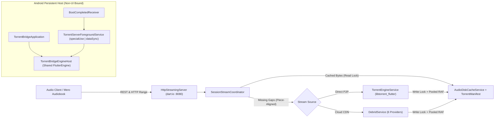

# Torrent Bridge

**Local Torrent-to-HTTP Audio Streaming Server for Android**

Torrent Bridge exposes peer-to-peer BitTorrent and Debrid cloud audio streams over a local `dart:io` HTTP server with byte-range (`206 Partial Content`) support, piece-aware persistent caching, low-latency seek coordination, and background service resilience designed for sideloaded (non-Play Store) Android devices and companion players such as **Mero Audiobook**.

| Stack | Runtime | Target Platform | Package ID |
| --- | --- | --- | --- |
| Flutter / Dart (`^3.13.5`) | `libtorrent_flutter` `1.7.8` | Android (API 24+) | `com.rehesagar.torrentbridge` |

---

## Core Capabilities

| Area | Capabilities |
| --- | --- |
| **HTTP Streaming Server** | Exposes REST control endpoints and `GET` / `HEAD` / `OPTIONS` byte-range audio streaming (`Range: bytes=start-end`, `bytes=start-`, `bytes=-suffix`) with CORS headers, live client tracking, MIME inference, and optional token auth (`X-Auth-Token`, `Authorization: Bearer`, `?token=`). |
| **Piece-Aware Disk Cache** | Tracks byte ranges alongside BitTorrent file-offset and `pieceLength` geometry inside atomic `<cachePath>/manifests/<infoHash>.manifest.json` files. Serves cached ranges directly from disk, inspects piece coverage, and stitches cached spans with uncached upstream windows. |
| **Low-Latency Seeking** | Coordinates single-flight upstream fetches per session (`SessionStreamCoordinator`): aborts superseded `HttpClientRequest` sockets immediately on seek, debounces rapid scrubbing (`110 ms` uncached / `0 ms` cached), uses piece-aligned sliding windows, detects stalls (`12 s` P2P / `18 s` Debrid), and backpressures socket writes via `StreamIterator`. |
| **Debrid Cloud Integration** | Validates keys and resolves direct CDN stream URLs across 6 providers (`AllDebrid`, `Debrid-Link`, `Offcloud`, `Premiumize`, `Real-Debrid`, `TorBox`), with configurable P2P fallback (`fallback_to_torrent_on_debrid_failure`, OFF by default). |
| **Background Survival** | Separates the `FlutterEngine` from `MainActivity` via `TorrentBridgeEngineHost` and `TorrentBridgeApplication`, runs a `specialUse \| dataSync` foreground service with `WakeLock` + `WifiLock`, handles `BOOT_COMPLETED` / `MY_PACKAGE_REPLACED` / `onTaskRemoved` alarms, monitors network changes, and provides battery-exemption and OEM autostart helpers. |
| **Sideload Self-Updater** | Checks GitHub `update.json`, verifies APK magic bytes while downloading, and invokes Android `FileProvider` package installation (`REQUEST_INSTALL_PACKAGES`). |

---

## Architecture



### Project Layout

```text
torrent_bridge/
|-- lib/
|   |-- main.dart                                 # App entry point and headless autostart bootstrap
|   |-- models/
|   |   |-- debrid_models.dart                    # DebridProvider definitions and validation models
|   |   `-- streaming_models.dart                 # AudioFileEntry, ConnectedClientInfo, StreamingSession
|   |-- screens/
|   |   `-- home_screen.dart                      # 3-tab UI: Server, Torrents, Settings & Cache
|   `-- services/
|       |-- android_foreground_service.dart       # MethodChannel bridge, BackgroundHealthStatus, OEM helpers
|       |-- app_update_service.dart               # Sideloaded APK update checker and FileProvider installer
|       |-- audio_disk_cache_service.dart         # Piece-aware disk cache, manifests, range locking & pooled I/O
|       |-- debrid_service.dart                   # Provider API validation and direct link resolution
|       |-- http_streaming_server.dart            # HTTP control/streaming server, watchdog, hybrid stitcher
|       |-- server_settings_service.dart          # Preferences, LRU quota enforcement, duplicate raw cleanup
|       |-- stream_fetch_coordinator.dart         # Single-flight seek cancellation, read-ahead & stall recovery
|       `-- torrent_engine_service.dart           # libtorrent_flutter wrapper, metadata & manifest sync
|-- android/app/src/main/
|   |-- AndroidManifest.xml                       # specialUse FGS, boot/package receivers, FileProvider
|   `-- kotlin/com/rehesagar/torrentbridge/
|       |-- BootCompletedReceiver.kt              # Restores server after reboot or APK replacement
|       |-- MainActivity.kt                       # Attaches to shared engine without destroying on finish
|       |-- TorrentBridgeApplication.kt           # Pre-warms shared engine when keep-running is active
|       |-- TorrentBridgeEngineHost.kt            # Singleton FlutterEngine, OEM power intents & health checks
|       `-- TorrentServerForegroundService.kt     # specialUse/dataSync FGS, WakeLock, WifiLock, NetCallback
|-- test/
|   |-- app_update_test.dart
|   |-- debrid_test.dart
|   |-- smart_cache_and_seek_test.dart
|   `-- widget_test.dart
`-- tool/
    |-- generate_icons.py
    `-- test_streaming_server.py                  # Python end-to-end HTTP Range verification client
```

---

## Supported Formats & Providers

### Audio Extensions & MIME Types

| Extension | Content-Type | Format Label |
| --- | --- | --- |
| `.mp3` | `audio/mpeg` | `MP3` |
| `.m4a`, `.m4b`, `.m4p` | `audio/mp4` | `M4A`, `M4B`, `M4P` |
| `.aac` | `audio/aac` | `AAC` |
| `.flac` | `audio/flac` | `FLAC` |
| `.ogg`, `.oga` | `audio/ogg` | `OGG`, `OGA` |
| `.opus` | `audio/opus` | `OPUS` |
| `.wav` | `audio/wav` | `WAV` |
| `.wma` | `audio/x-ms-wma` | `WMA` |
| `.weba` | `audio/webm` | `WEBA` |
| `.mp4` | `video/mp4` | `MP4` |

### Debrid Providers

Configured in the **Settings** tab or via `POST /api/settings`:

- `alldebrid` (AllDebrid)
- `debridlink` (Debrid-Link)
- `offcloud` (Offcloud)
- `premiumize` (Premiumize)
- `realdebrid` (Real-Debrid)
- `torbox` (TorBox)
- `none` (Direct P2P Torrent)

---

## HTTP API Reference

Default bind port is `8080`. All endpoints emit CORS headers (`Access-Control-Allow-Origin: *`). When an authentication token is configured, clients can pass it via `X-Auth-Token`, `Authorization: Bearer <token>`, or `?token=<token>`.

### Endpoint Summary

| Method | Path | Purpose |
| --- | --- | --- |
| `GET` | `/`, `/status`, `/api/status` | Server state, LAN/loopback IPs, connected clients, and active sessions |
| `POST` | `/api/stream`, `/stream` | Resolve or reuse a streaming session and return session URLs + telemetry |
| `GET`, `HEAD` | `/stream/<sessionId>/<fileName>` | Stream audio with `Accept-Ranges: bytes` and `206 Partial Content` |
| `GET`, `HEAD` | `/audio?magnet=...&file_path=...` | Direct resolve-and-stream convenience endpoint (`infohash` / `file_index` also accepted) |
| `POST` | `/api/torrent/inspect` | Resolve torrent metadata and file list without starting playback |
| `GET` | `/api/sessions` | List active `StreamingSession` objects |
| `DELETE` | `/api/stream/<sessionId>` | Stop and dispose a streaming session |
| `GET`, `DELETE` | `/api/cache` | Refresh disk usage stats or clear cache (preserving active sessions) |
| `DELETE` | `/api/cache/torrent/<infoHash>` | Delete cached files and manifest for a specific torrent |
| `GET`, `POST` | `/api/settings` | Read or update cache limits, read-ahead buffer, priority flags, and Debrid settings |

### Create Stream (`POST /api/stream`)

**Request:**

```json
{
  "magnet": "magnet:?xt=urn:btih:2a72c612335bd7cc5221b9c20838a9a349cf3821",
  "file_path": "Audiobook/Chapter 01.mp3"
}
```

> Also accepts `"infohash"` (or `"uri"`) instead of `"magnet"`, and `"file_index"` instead of `"file_path"`.

**Response (`200 OK`):**

```json
{
  "status": "ok",
  "session_id": "s1_1_0",
  "torrent_id": 1,
  "native_stream_id": 1,
  "infohash": "2a72c612335bd7cc5221b9c20838a9a349cf3821",
  "torrent_name": "Example Audiobook",
  "file_index": 0,
  "file_name": "Chapter 01.mp3",
  "file_path": "Audiobook/Chapter 01.mp3",
  "file_size": 12345678,
  "mime_type": "audio/mpeg",
  "format": "MP3",
  "stream_url": "http://192.168.1.10:8080/stream/s1_1_0/Chapter%2001.mp3",
  "loopback_stream_url": "http://127.0.0.1:8080/stream/s1_1_0/Chapter%2001.mp3",
  "stream_source": "torrent",
  "is_cached": false,
  "cached_bytes": 0,
  "cached_percentage": 0.0
}
```

### Runtime Settings (`GET` / `POST /api/settings`)

Configurable fields accepted by `POST /api/settings`:

| Key | Type | Notes |
| --- | --- | --- |
| `max_cache_size_bytes` / `max_cache_size_mb` | `int` | Clamped between `128 MB` and `16 GB` (default `2 GB`) |
| `read_ahead_buffer_bytes` / `read_ahead_buffer_mb` | `int` | Clamped between `4 MB` and `64 MB` (default `16 MB`) |
| `prioritize_newest` | `bool` | Boosts priority for the active/newest torrent stream |
| `auto_pause_background` | `bool` | Pauses secondary background torrents when primary stream switches |
| `fast_audio_preload` | `bool` | Enables cancellable head (`512 KB`) and tail (`256 KB`) warmup |
| `debrid_provider` | `string` | One of `none`, `alldebrid`, `debridlink`, `offcloud`, `premiumize`, `realdebrid`, `torbox` |
| `debrid_api_key` | `string` | API key for the selected `debrid_provider` |
| `fallback_to_torrent_on_debrid_failure` | `bool` | Falls back to direct P2P when Debrid resolution fails (default `false`) |

---

## Caching, Seeking & Android Behavior

- **Piece Geometry Inference**: On metadata resolution and stream start, `TorrentManifest` records each file's `offset` and `length` and infers the nearest power-of-two BitTorrent `pieceLength` from `StreamInfo.readaheadWindow` (`16 MB / readaheadWindow`). `DiskCacheEntry` maps any byte range `[start, end]` to `[startPiece, endPiece]` and computes missing gaps against stored byte intervals.
- **Duplicate Raw File Pruning**: During LRU quota enforcement (`checkAndEnforceCacheLimit`), raw libtorrent folders belonging to torrents already 100% cached inside the piece-aware stream store are pruned before evicting unique cached entries. Manifest files (`manifests/*.manifest.json`) are excluded from raw cleanup.
- **Fast-Path Resume**: When a session already has a persisted manifest or partial disk cache entry on P2P mode, `createOrGetStreamSession` creates the HTTP session immediately without blocking on live peer metadata, while native torrent activation runs asynchronously.
- **Android OEM Recommendations**: Swiping the app from Recents keeps the foreground service and shared `FlutterEngine` alive. On devices with aggressive background killers (Xiaomi MIUI/HyperOS, Oppo/Realme, Vivo, OnePlus, Huawei, Samsung), open **Settings -> Background Survival (Non-Play Store)** to grant **Ignore Battery Optimizations**, **Unrestricted Data**, and OEM **Autostart**.

---

## Development, Testing & Verification

### Prerequisites

- Flutter SDK (`^3.13.5`) and Android SDK (`minSdk 24`)
- Python 3.12 (optional, for the end-to-end HTTP verification script)

### Commands

```powershell
# Install dependencies
flutter pub get

# Run static analysis
flutter analyze

# Run unit, HTTP seek/cache, Debrid, updater, and widget tests
flutter test

# Build debug Android APK
flutter build apk --debug
```

### End-to-End HTTP Verification Script

With the Android app running locally (or forwarded over ADB with `adb forward tcp:8080 tcp:8080`):

```powershell
py -3.12 tool/test_streaming_server.py --host 127.0.0.1 --port 8080
```
